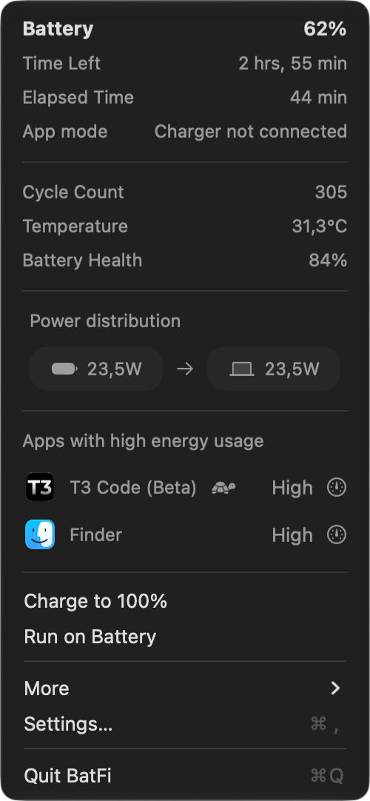
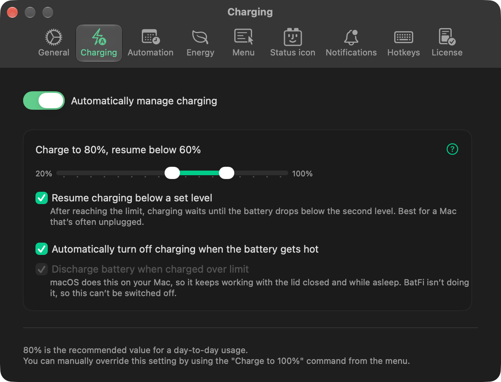
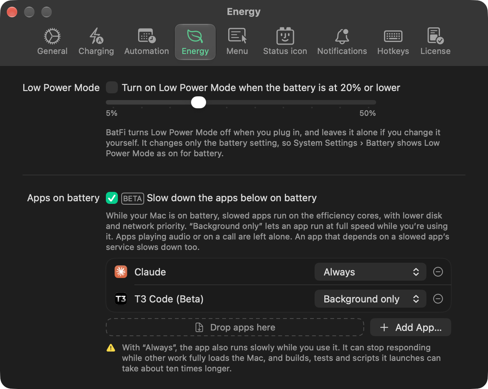

# BatFi

BatFi is a battery charge limiter for Mac. Stop charging at 80%, or hold any
limit. Change it by time and place. Charge to 100% the moment you need it.

**[Download BatFi at micropixels.software/batfi](https://micropixels.software/batfi/)**

$15, once. Not a subscription. One licence covers every Mac you own.
Try it free for 7 days first, with no card, email or account. Every feature
works during the trial, and each Mac gets one trial.
Requires macOS Sonoma 14.8 or later on a Mac with Apple silicon.

This repository holds BatFi's source code. It is updated with a snapshot of
the current code from time to time, so it can be a little behind the app you
download.

## BatFi and the charge limit in macOS

Keeping a lithium-ion battery at a high charge wears it faster.

Since macOS Tahoe 26.4, a Mac with Apple silicon can stop charging anywhere
from 80% to 100%. BatFi does much more:

- Holds any limit, below 80% included.
- Changes the limit by time and place.
- Charges to 100% in one click when you need the power.
- Pauses charging when the battery gets hot.
- Shows which apps are using a lot of energy.
- Shows battery health, cycle count, temperature and time left on battery.
- Reminds you when the battery hasn't been run down and fully charged in a while.
- Turns on Low Power Mode from a keyboard shortcut, in any app.

It runs on macOS Sonoma 14.8 and later. With BatFi, turn off the limit in
macOS and Optimized Battery Charging.

More, and the download, at [micropixels.software/batfi](https://micropixels.software/batfi/).
Questions are answered in [BatFi's FAQ](https://micropixels.software/support/#batfi).

  
  

  

## Licence

The source code in this repository is under the MIT licence (see `LICENSE`).

The BatFi app you buy and download from micropixels.software or Gumroad is
covered by the BatFi Personal Use License Agreement
(`Supporting Files/license.rtf`), which the installer shows. That agreement
applies to the built app only, not to this code.

## Building

- Build with Xcode (open `BatFi.xcodeproj`, scheme BatFi) or `xcodebuild`.
  `swift build` and `swift test` don't work for this project.
- Tests: `xcodebuild test -project BatFi.xcodeproj -scheme AppSharedTests -destination 'platform=macOS'`.
- The app and its privileged helper must be signed by the same team. Set your
  own development team in the project's Signing & Capabilities settings for
  the app and the helper.
- `BatFiKit/Sources/ClientsLive/AnalyticsDSN.swift` is a stub with an empty
  crash-reporting DSN, so your builds send no crash reports. Official builds
  replace it in CI. Don't commit a real DSN into it.

## Localization

The app uses [String Catalog](https://developer.apple.com/documentation/xcode/localizing-and-varying-text-with-a-string-catalog) which makes localization super straightforward.

If you know how to use Git

1) Install Xcode ([Mac App Store](https://apps.apple.com/us/app/xcode/id497799835?mt=12))
2) Fork this repo, the develop branch
3) There are two `.xcstrings` files. One related to the app's UI and second one for the App Intents (used for Siri Shortcuts):
- App UI `./BatFiKit/Sources/L10n/Localizable.xcstrings`
- App Intents `./App/Localizable.xcstrings`
4) Open and edit them with Xcode. I highly recommend to use Apple conventions for basic commands, like "Quit" etc. You can find all of them on [Apple Localization Terms Glossary](https://applelocalization.com/macos)
5) Commit changes and make pull request

If you have no idea what Git is

1) Install Xcode ([Mac App Store](https://apps.apple.com/us/app/xcode/id497799835?mt=12))
2) Download [App UI Localizable.xcstrings](https://github.com/rurza/BatFi/blob/develop/BatFiKit/Sources/L10n/Localizable.xcstrings) using the "Download raw file" button in the top right corner
3) Download [App Intents Localizable.xcstrings](https://github.com/rurza/BatFi/blob/develop/App/Localizable.xcstrings) using the "Download raw file" button in the top right corner
4) Open and edit downloaded file. It'll open in Xcode. I highly recommend to use Apple conventions for basic commands, like "Quit" etc. You can find all of them on [Apple Localization Terms Glossary](https://applelocalization.com/macos)
5) Send it to me: adam@micropixels.pl

### Adding strings in code

UI strings live in `BatFiKit/Sources/L10n` as `String(localized:defaultValue:bundle: .module)` wrappers. After changing them, or after editing `Localizable.xcstrings` by hand, run `scripts/sync-localizable-strings` and commit what it writes. It adds new keys and rewrites the catalog exactly as Xcode does after a build, so the next build leaves it untouched. Don't set `extractionState` by hand; never mark a key `manual`. AppSharedTests fails if the catalog isn't in that form.
